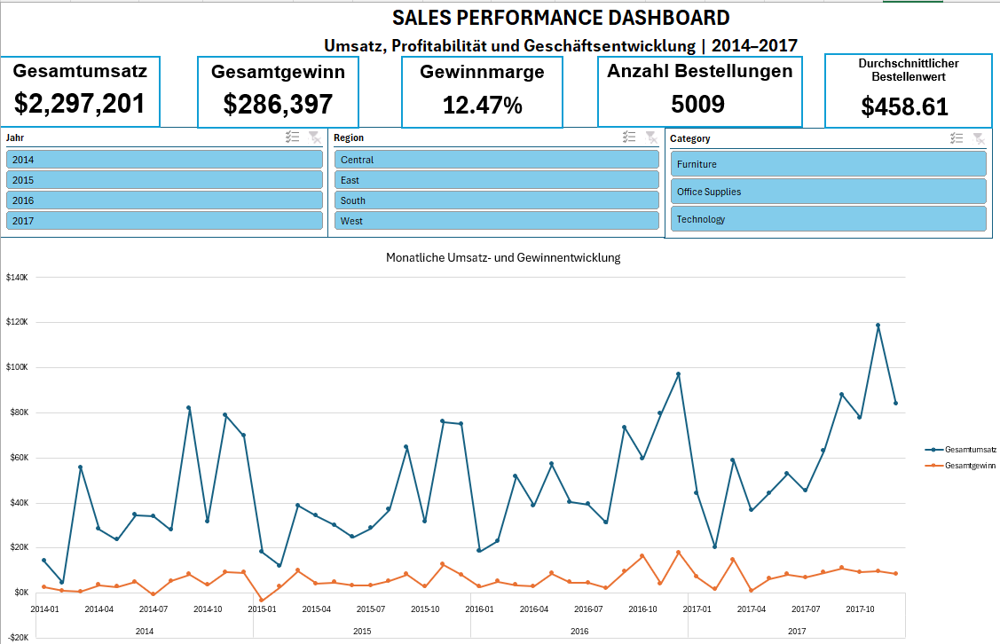
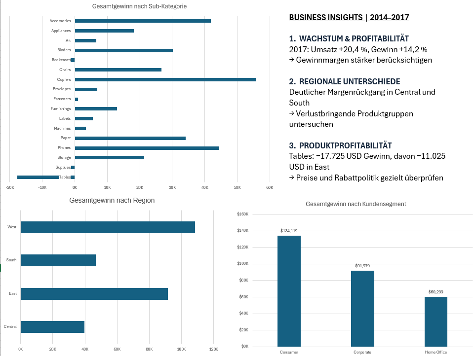

# Sales Performance Analysis | Excel

## Über das Projekt

In diesem Projekt habe ich Verkaufsdaten mit Excel ausgewertet und ein interaktives Dashboard erstellt. Dabei wollte ich vor allem verstehen, welche Produkte besonders viel Umsatz erzielen, wie sich die Gewinne entwickeln und ob hohe Verkaufszahlen auch mit einer guten Rentabilität verbunden sind.

Als Grundlage habe ich den Sample-Superstore-Datensatz verwendet, der Informationen zu Bestellungen, Produkten, Kunden und Regionen enthält.

## So bin ich vorgegangen

Zunächst habe ich die Daten in Excel vorbereitet und mit Power Query überprüft. Anschließend habe ich PivotTables und PivotCharts erstellt, um die Verkaufszahlen aus verschiedenen Perspektiven zu betrachten.

Im letzten Schritt habe ich die Auswertungen in einem Dashboard zusammengeführt. Besonders wichtig war mir, dass die verschiedenen Diagramme und Kennzahlen miteinander verbunden sind und sich über Slicer gemeinsam filtern lassen.

Das Dashboard zeigt fünf zentrale Kennzahlen:

- Gesamtumsatz
- Gesamtgewinn
- Gewinnmarge
- Anzahl der Bestellungen
- Durchschnittlicher Bestellwert

Zusätzlich lassen sich die Umsatz- und Gewinnentwicklung sowie die Ergebnisse einzelner Produktkategorien, Unterkategorien und Kundensegmente untersuchen.

## Excel-Dashboard

Das Dashboard zeigt die wichtigsten Kennzahlen zur Verkaufsleistung und ermöglicht es, Umsatz und Rentabilität nach Zeitraum, Produktkategorie und Kundensegment zu untersuchen.

## Was ich bei der Analyse interessant fand

### Umsatz und Gewinn erzählen nicht immer dieselbe Geschichte

Bei der Arbeit mit dem Dashboard habe ich mich besonders mit dem Verhältnis zwischen Umsatz und Gewinn beschäftigt.

Hohe Verkaufszahlen wirken zunächst positiv. Für die wirtschaftliche Bewertung ist aber mindestens genauso wichtig, wie viel Gewinn tatsächlich übrig bleibt. Deshalb habe ich im Dashboard nicht nur den Umsatz, sondern auch die Gewinnmarge berücksichtigt.

### Die Filter machen Unterschiede sichtbar

Interessant fand ich außerdem, wie stark sich die Perspektive auf die Daten verändern kann, wenn man einzelne Jahre, Kategorien oder Kundensegmente auswählt.

Mit den Slicern kann man die Gesamtentwicklung genauer untersuchen und beispielsweise prüfen, ob eine Produktgruppe über einen längeren Zeitraum rentabel bleibt oder nur in bestimmten Monaten gute Ergebnisse erzielt.

### Ein übersichtliches Dashboard ist wichtiger als möglichst viele Diagramme

Während der Erstellung habe ich auch gemerkt, dass nicht jede zusätzliche Visualisierung einen Mehrwert bringt.

Deshalb habe ich mich darauf konzentriert, die wichtigsten Kennzahlen und Vergleiche so darzustellen, dass man schnell einen Überblick bekommt und bei Bedarf einzelne Bereiche genauer untersuchen kann.

## Was ich einem Unternehmen empfehlen würde

**1. Nicht nur den Umsatz im Blick behalten**

Ich würde die Rentabilität regelmäßig auf Ebene der Produktkategorien und Unterkategorien überprüfen. Besonders interessant wären Bereiche, in denen Umsatz und Gewinn sehr unterschiedlich verlaufen.

**2. Auffällige Verluste genauer untersuchen**

Falls bestimmte Produkte oder Kundensegmente wiederholt geringe oder negative Gewinne erzielen, würde ich zunächst prüfen, ob sich diese Entwicklung auf einzelne Zeiträume konzentriert oder über längere Zeit besteht.

**3. Veränderungen über mehrere Zeiträume vergleichen**

Anstatt Entscheidungen auf Grundlage eines einzelnen Monats zu treffen, würde ich die Entwicklung über mehrere Monate und Jahre betrachten. So lassen sich kurzfristige Schwankungen besser von längerfristigen Veränderungen unterscheiden.

## Was ich aus dem Projekt mitgenommen habe

Dieses Projekt war mein Einstieg in die praktische Datenanalyse mit Excel. Ich habe dabei gelernt, größere Datensätze mit Power Query vorzubereiten, PivotTables für unterschiedliche Fragestellungen zu nutzen und die Ergebnisse in einem interaktiven Dashboard zusammenzuführen.

Am meisten habe ich aus der Arbeit an den Kennzahlen und Filtern mitgenommen. Dabei wurde mir klar, dass es nicht ausreicht, Daten einfach nur in Diagrammen darzustellen. Man muss auch verstehen, was die Zahlen aussagen und welche Fragen sich daraus ergeben.

## Verwendete Tools

- **Excel:** Datenanalyse und Dashboard-Erstellung
- **Power Query:** Datenaufbereitung
- **PivotTables und PivotCharts:** Auswertung und Visualisierung
- **Power Pivot:** Datenmodellierung
- **Slicer:** Interaktive Filter
